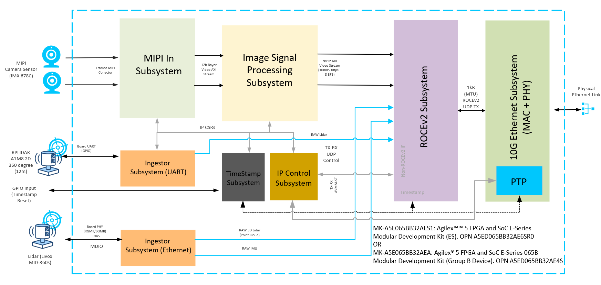
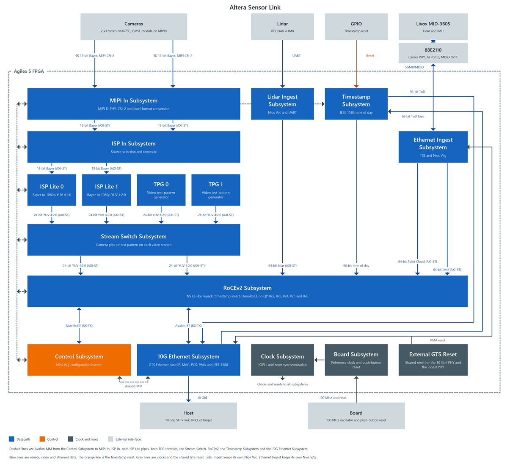

# Architecture

The architecture integrates camera, lidar, and Ethernet ingestion, lightweight FPGA-based processing, IEEE 1588 timestamping, and high-speed network delivery into a single Agilex™ 5 device. Sensor data is captured through dedicated FPGA subsystems, conditioned or forwarded as defined by the scope of this release and transmitted to the host through a unidirectional RoCEv2 path over 10 GbE. Five RoCEv2 channels carry two camera streams, the two-dimensional lidar stream, and the two Ethernet ingest streams (Point Cloud and IMU). Figure 1 provides a high-level view of this end-to-end data path, while Figure 2 presents the principal implementation blocks in greater detail.

*Figure 1. Altera Sensor Link — functional block diagram.*

Figure 1 presents the high-level functional architecture and the end-to-end data path from sensor ingestion to host delivery. The design is implemented as a single-FPGA pipeline hosted either on  **MK-A5E065BB32AES1 Agilex™ 5 E-Series Modular Development Kit, OPN A5ED065BB32AE6SR0 or MK-A5E065BB32AEA: Agilex® 5 FPGA and SoC E-Series 065B Modular Development Kit (Group B Device).** Clock and reset trees are omitted from the figure for clarity.

The sensor-ingestion layer consists of a MIPI In Subsystem for the IMX678C camera inputs, a Lidar In Subsystem for the RPLIDAR A1M8, and an Ethernet Ingest Subsystem for a Livox MID-360S. The MIPI0 input is the first camera connection and supports a Framos GMSL camera module; this GMSL support is limited to MIPI0. The two-dimensional lidar connects through a board-level UART interface. The Livox MID-360S connects through SGMII/MDIO to the carrier 88E2110 PHY on J4 Port B. The Ethernet Ingest Subsystem uses a Triple-Speed Ethernet MAC and its own Nios V/g processor, and it forwards two raw 64-bit streams, point cloud and IMU, into RoCEv2. The Control Subsystem configures the IP on its Avalon-MM map. The Timestamp Subsystem provides the common time reference used across sensor streams. It broadcasts the IEEE 1588 96-bit time of day to the 10G Ethernet MAC on one Avalon-ST connection and receives the time-of-day load on a second Avalon-ST connection, and it supplies that time reference to RoCEv2. An external GPIO input resets the timestamp.

The camera sensors provide 4K, 12-bit Bayer video. The MIPI In Subsystem delivers this data as a 12-bit Bayer video AXI4-Stream to the ISP In Subsystem. Each ISP Lite pipe performs the defined lightweight conditioning and produces an 8-bit YUV420 video stream at 1080p and 30 frames per second. The two ISP Lite outputs and the two video test-pattern generators enter the Stream Switch, which selects the two video streams forwarded to RoCEv2. The lidar path forwards the raw sensor data through the Lidar In Subsystem without transformation; the lidar data format is specified in [Data Formats](06-data-formats.md). RoCEv2 channels 0 and 1 carry the video streams, channel 2 carries the raw lidar stream, and channels 3 and 4 carry the Ethernet ingest point-cloud and IMU streams. Those streams are buffered, and the video streams are chroma-repacked, before encapsulation.

In the RoCEv2 Subsystem a chroma re-packer converts the ISP-generated YUV420 video to an NV12-like format for Ethernet transmission. The raw lidar, point-cloud, and IMU streams stay untransformed. The RoCEv2 Subsystem forwards the five transmit streams to the 10G Ethernet Subsystem, which contains the 10G GTS Ethernet Hard IP functionality (MAC, PCS, and PMA functions) and provides the physical Ethernet interface to the host. A separate external GTS reset sequencer is shared by that 10G MAC and the Ethernet ingest PHY. In summary, Figure 1 defines the data path as heterogeneous sensor ingestion → AXI4-Stream processing and format standardization → five-channel RoCEv2 transmit → 10 GbE host delivery, entirely within the Agilex™ 5 device.

*Figure 2. Altera® Sensor Link Functional Block Diagram.*

Figure 2 expands the principal implementation blocks shown in Figure 1. The MIPI In Subsystem includes the MIPI D-PHY, MIPI CSI-2 processing, and pixel-format conversion required to deliver camera data to the ISP path. The camera sensors capture 4K, 12-bit Bayer video, while the ISP Lite output is 1080p, 30 frames per second, 8-bit YUV420. The detailed diagram shows parallel ISP Lite pipelines for the supported camera streams. The implementation also includes the Stream Switch ahead of the RoCEv2 video channels and the Ethernet Ingest Subsystem for the Livox MID-360S point-cloud and IMU streams.

Each ISP Lite pipeline provides the defined lightweight processing stages, including black-level correction, white-balance correction, demosaicing, color correction, and scaling or chroma resampling as required to produce the YUV420 output. Those outputs, together with the two test-pattern generators, connect to the Stream Switch. The Lidar Subsystem includes a Nios® V/c control path, the UART interface, raw sensor-data forwarding, on-chip memory, and register control. The Ethernet Ingest Subsystem includes a Nios® V/g control path, the Triple-Speed Ethernet MAC, and the SGMII/MDIO connection to the 88E2110 PHY.

The Control Subsystem listens to the UDP packets described in the [Altera Control Link](08-altera-control-link.md) section and reads or writes the IP connected to its Avalon-MM interface. That interface covers MIPI In, ISP In, both ISP Lite pipes, both video test-pattern generators, the Stream Switch, RoCEv2, the Timestamp Subsystem, and the 10G Ethernet Subsystem. Ethernet Ingest keeps its own Nios V/g, and Lidar Ingest keeps its own Nios V/c. Both sit outside this Avalon-MM interface. The Timestamp Subsystem provides the time-of-day and timestamping functions used to associate a common timestamp with captured sensor data, including the IEEE 1588 time-of-day exchange with the 10G MAC. Within the RoCEv2 Subsystem, the video, lidar, and Ethernet ingest paths are handled by separate stream shims and the VVP-to-ABR bridge before entering the transmit and stream-control logic. The video path includes a chroma re-packer that converts the ISP-generated YUV420 stream to the NV12-like format used for Ethernet transmission. The lidar, point-cloud, and IMU paths remain raw through this processing chain.

The FPGA implementation organized as the Platform Designer subsystems of the Quartus project is described in the following sections.

---

[← Scope](02-scope.md) | [Documentation index](README.md) | [Bill of Materials →](04-bill-of-materials.md)
