# Getting Started: Hardware Connection

This is part 1 of 3 of Getting Started: [Hardware Connection](04-getting-started-1-hardware-connection.md), [Configure the Board](05-getting-started-2-configure-the-board.md), [Execute the Control Plane](06-getting-started-3-execute-the-control-plane.md).

## Hardware Configurations

Select the appropriate hardware configuration according to the SOF being used.

### Full Configuration

This is the full configuration for all five streams. Use this configuration to connect two Framos IMX678C sensors directly to the development kit using flex/ribbon cables (optionally MIPI0 can interface with a Framos GMSL module) and to connect the lidar to the 2x4 GPIO header on the carrier board (J23). The Ethernet-based sensor (Livox MID-360S) should be connected to the lower port of the RJ-45 connector at the back of the board (J4).

Use this configuration to test the streams.

  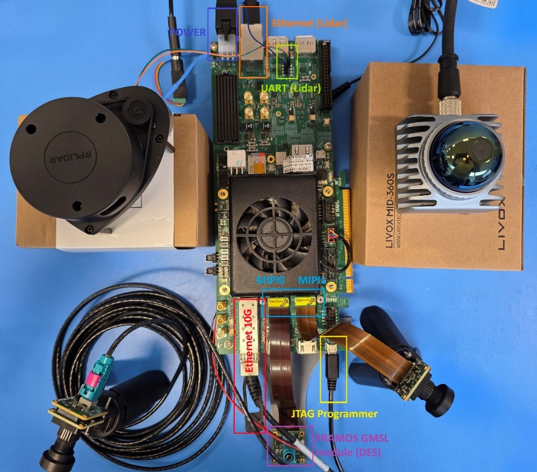

<strong>Figure 3. Full Hardware Configuration.</strong>

 

The UART connection is on header J23.

  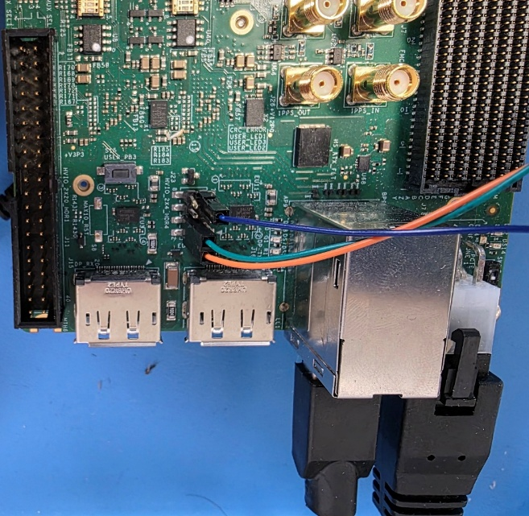

<strong>Figure 4. UART Connections to header J23.</strong>

 

Only the lower RJ-45 port at the back of the development kit (J4, ETH0-Lower) is enabled for the Livox MID-360S 3D lidar.

  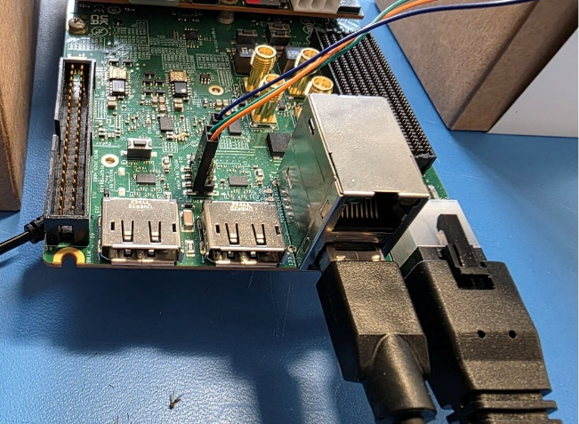

<strong>Figure 5. Ethernet Connection (Sensor) Lower RJ-45 port.</strong>

 

The RPLIDAR is also connected to the J23 2x4-pin connector.

  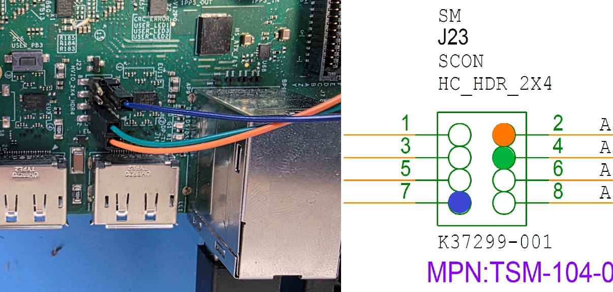

<strong>Figure 6. 2x4-pin (J23) GPIO/UART connections.</strong>

 

Connections from the RPLIDAR to the HVIO 2 × 4 header (wire colors in the images: blue is lidar GND to pin 7, orange is lidar TX to board RX on pin 2, and green is lidar RX to board TX on pin 4).

Note 1: To use the video test-pattern generators (TPG), you can disconnect the cameras from the MIPI ports. You must also change the internal video switch configuration in the Stream Switch Subsystem. The non-default configuration in the Altera® Control Link should look like this:

  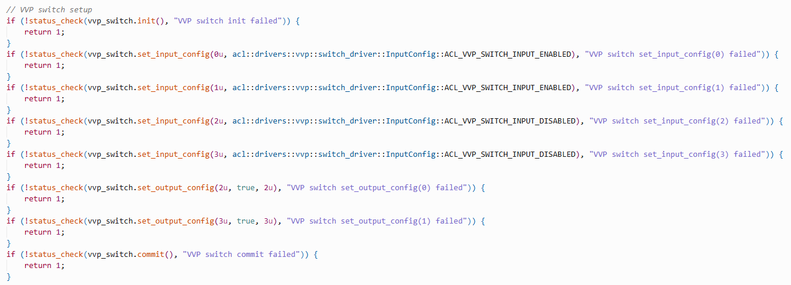

<strong>Figure 7. Hardware Configuration 2.</strong>

 

Note 2: To connect the MIPI0 camera without the GMSL module, you must disable the GMSL module in the Altera® Control Link initialization. The initialization should look like this:

  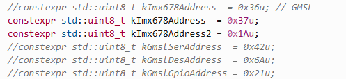

Then comment out the GMSL module initialization:

  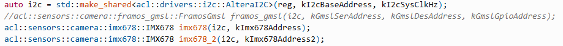

  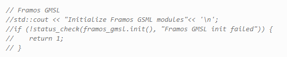

### Lidar cable rework

The lidar cables must be reworked to connect to the 2x4-pin GPIO connector on the development kit. Follow the steps below.

#### Equipment and hardware

- 5 V power supply with barrel connector breakout ([link](https://www.amazon.co.uk/dp/B09SG46W44))
- 2.54 mm pitch crimp pins and housing
- PB1.25 4-pin and 3-pin connectors for the RPLIDAR

#### Wiring harness

  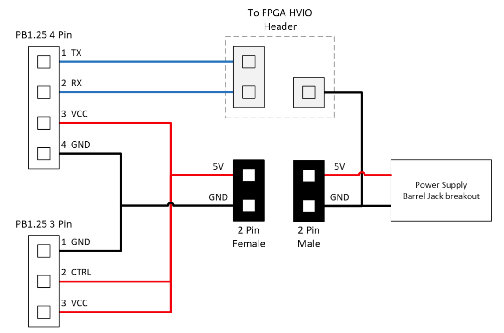

<strong>Figure 8. Lidar wiring harness diagram.</strong>

 

- The VCC lines of both connectors and the motor CTRL signal are combined onto a common 5 V supply. This causes the lidar motor to operate at its maximum speed.
- The GND lines from both connectors are also combined onto a common ground.

  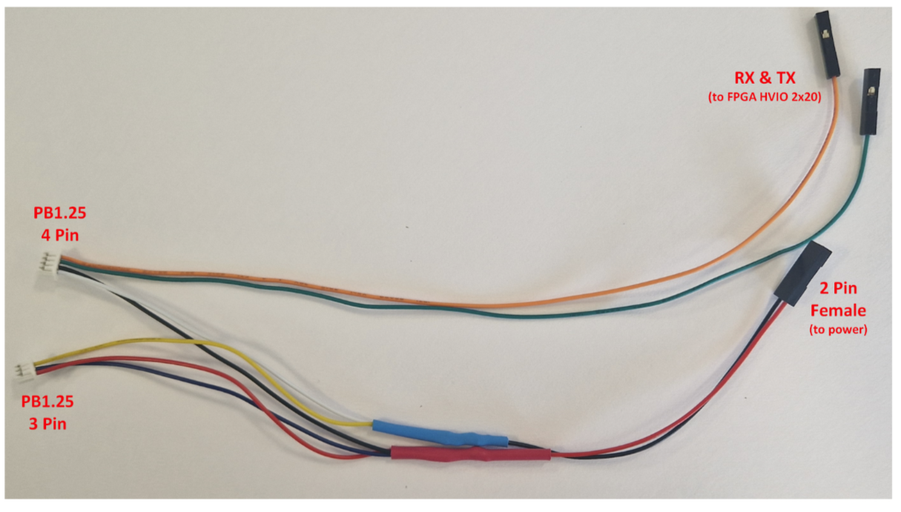

<strong>Figure 9. Wiring Harness (RPLIDAR to FPGA & Power).</strong>

 

  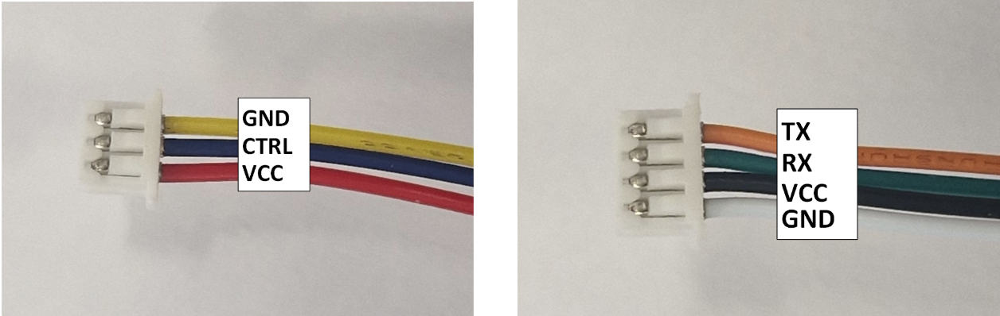

<strong>Figure 10. 3 Pin Motor Connector / 4 Pin UART Connector.</strong>

 

- Solder the GND wire of the 3-pin connector (yellow) to the GND wire of the 4-pin connector (white).
- Solder the VCC and CTRL wires of the 3-pin connector (blue and red) together with the VCC wire of the 4-pin connector (black).

  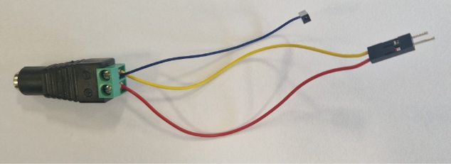

<strong>Figure 11. Wiring Harness (Barrel Connector Breakout).</strong>

 

#### Connection to the board

  

<strong>Figure 12. 2x4-pin (J23) GPIO/UART connections.</strong>

 

Connections from the RPLIDAR to the HVIO 2 × 4 header (wire colors in the images: blue is lidar GND to pin 7, orange is lidar TX to board RX on pin 2, and green is lidar RX to board TX on pin 4).

---

[← Bill of Materials](03-bill-of-materials.md) | [Documentation index](README.md) | [Getting Started: Configure the Board →](05-getting-started-2-configure-the-board.md)
