# Getting Started: Hardware Connection

This is part 1 of 3 of Getting Started: [Hardware Connection](05-getting-started-1-hardware-connection.md), [Configure the Board](05-getting-started-2-configure-the-board.md), [Execute the Control Plane](05-getting-started-3-execute-the-control-plane.md).

## Hardware Configurations

Select the appropriate hardware configuration according to the SOF being used.

### Full Configuration

This is the full configuration for 5 Channels of data. Use this configuration to connect two Framos IMX678C sensors directly to the development kit using flex/ribbon cables (optionally MIPI0 can interface with a FRAMOS GMSL module) and to connect the lidar to the 2x4 GPIO header on the carrier board (J23). The ethernet-based sensor (Livox MID-360S) should be connected to the lower port of the RJ-45 connector at the back of the board (J4)

Use this configuration to test the streams.

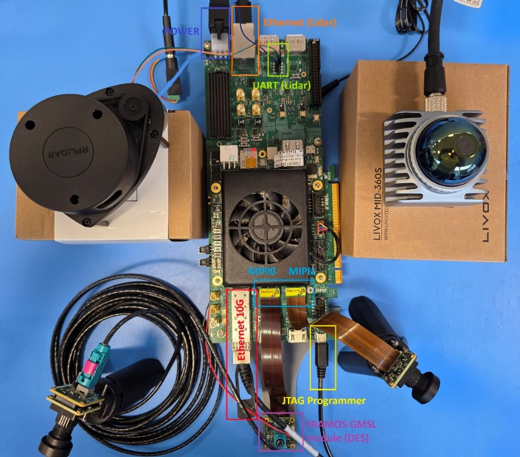

*Figure 3. Full Hardware Configuration.*

The UART connection is on header J23.

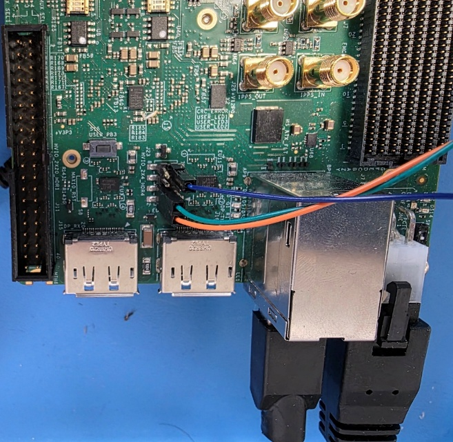

*Figure 4. UART Connections to header J23.*

Only the lower RJ-45 port at the back of the development kit has been enabled for the 3D Lidar (Livox MID-360S). Port J4 (ETH0-Lower).

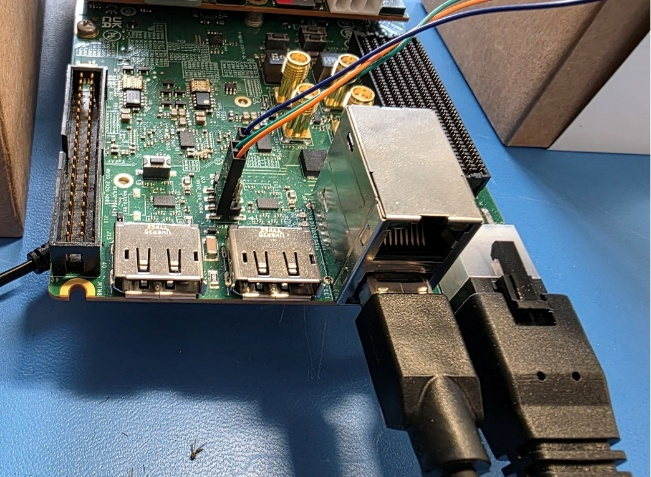

*Figure 5. Ethernet Connection (Sensor) Lower RJ-45 port.*

The lidar is also connected to the J23 2x4Pin connector.

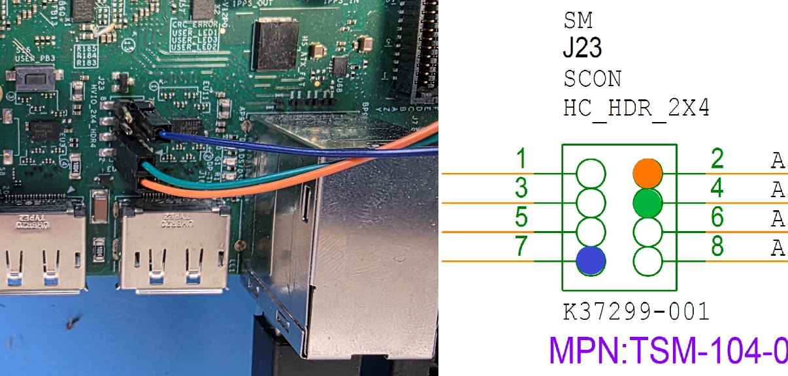

*Figure 6. 2x4-pin (J23) GPIO/UART connections.*

Connections from RPLIDAR to HVIO 2 × 4 Header (in the images: Blue (Lidar GND, Pin 7), Orange (Lidar TX / Board RX, Pin 2), Green (Lidar RX / Board TX, Pin 4).

Note 1: To use video TPG you can disconnect the cameras from the MIPI ports and you need to change the internal video switch configuration in the “Stream Switch Subsystem”, the non-default configuration in the control link should look like this:

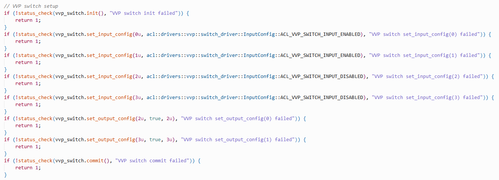

*Figure 7. Hardware Configuration 2.*

Note 2: To connect the MIPI0 camera without the GMSL module, you must “disable” or “not use” the GMSL module. The control link init should look like this:

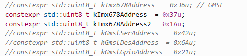

And comment-out the GMSL module init:

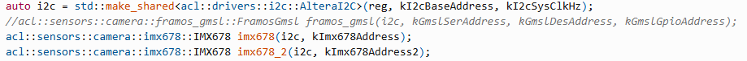

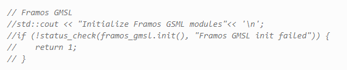

### Lidar cable re-work

The lidar cables must be reworked to connect to the 2x4-pin GPIO connector on the development kit. Follow the steps below.

#### Equipment and Hardware

- 5V Power Supply with Barrel Connector Breakout <https://www.amazon.co.uk/dp/B09SG46W44>
- 2.54mm pitch crimp pin connect + housing
- PB1.25 4 Pin and 3 Pin from RPLIDAR

#### Wiring Harness

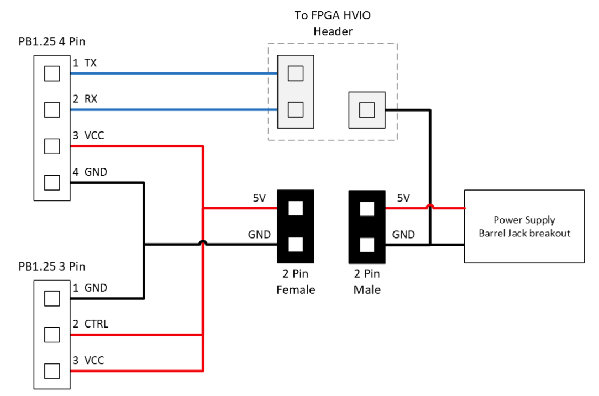

*Figure 8. Lidar wiring harness diagram.*

- The VCC lines of both connectors and the motor CTRL signal are combined onto a common 5 V supply. This causes the lidar motor to operate at its maximum speed.
- The GND lines from both connectors are also combined onto a common ground.

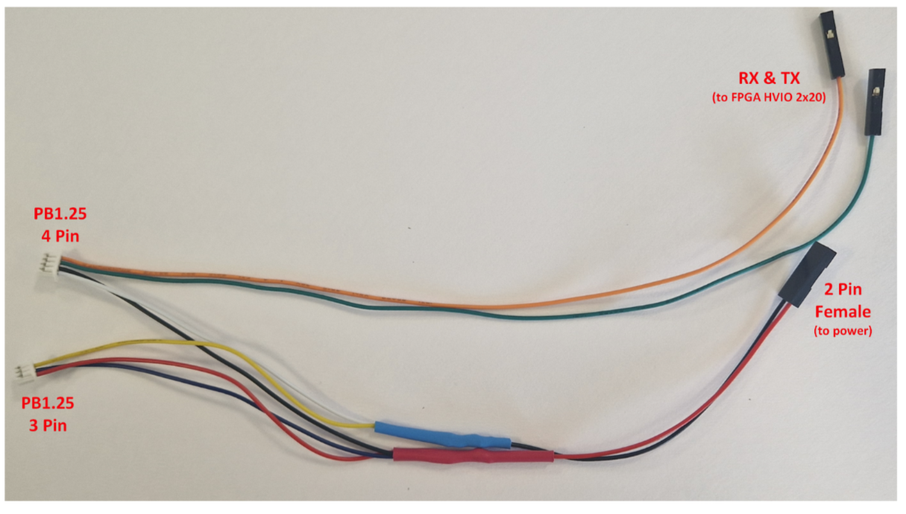

*Figure 9. Wiring Harness (RPLIDAR to FPGA & Power)*

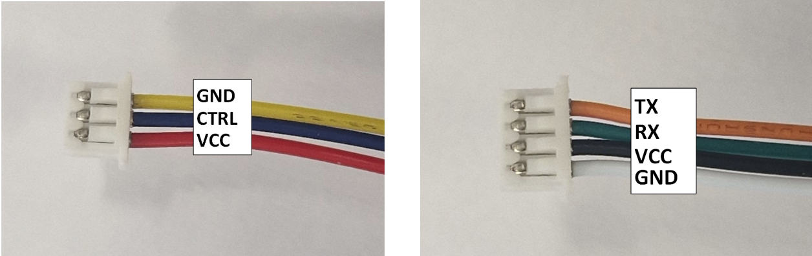

*Figure 10. 3 Pin Motor Connector / 4 Pin UART Connector*

- Solder GND from the 3 Pin (Yellow wire) with GND from the 4 Pin (White wire)
- Solder VCC and CTRL from the 3 Pin (Blue and Red wire) together with the VCC from the 4 Pin (Black wire)

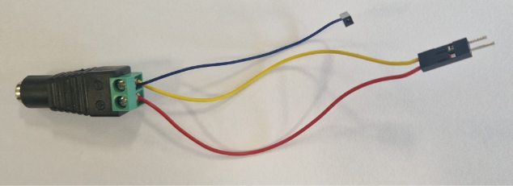

*Figure 11. Wiring Harness (Barrel Connector Breakout)*

#### Connection to the board

*Figure 12. 2x4-pin (J23) GPIO/UART connections.*

Connections from RPLIDAR to HVIO 2 × 4 Header (in the images: Blue (Lidar GND, Pin 7), Orange (Lidar TX / Board RX, Pin 2), Green (Lidar RX / Board TX, Pin 4).

---

[← Bill of Materials](04-bill-of-materials.md) | [Documentation index](README.md) | [Getting Started: Configure the Board →](05-getting-started-2-configure-the-board.md)
