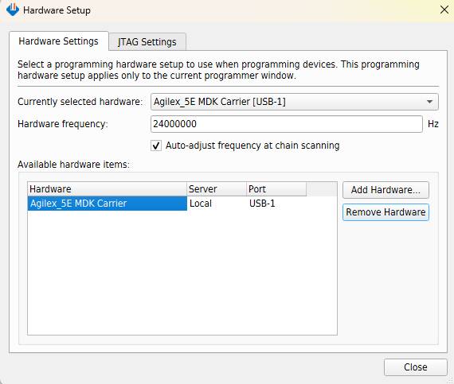
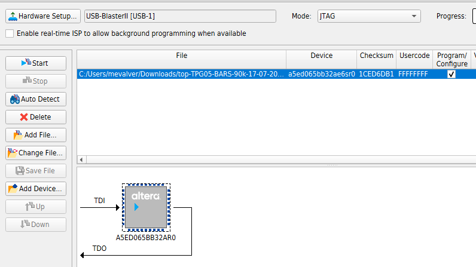

# Getting Started: Configure the Board

This is part 2 of 3 of Getting Started: [Hardware Connection](05-getting-started-1-hardware-connection.md), [Configure the Board](05-getting-started-2-configure-the-board.md), [Execute the Control Plane](05-getting-started-3-execute-the-control-plane.md).

## Run PTP in the host interface

Before programming the board, run PTP in your host device as a master. FPGA internal PTP engine only supports “secondary/slave” mode.

## Configure the board

Once all connections are ready according to the selected hardware configuration and SOF, follow these steps:

1. Get "Quartus Programmer 26.1" from:  <https://www.altera.com/downloads/fpga-development-tools/quartus-prime-pro-edition-design-software-version-26-1-windows>, from "Standalone Software Section".  Specifically <https://www.altera.com/download-center/license-agreement/127231/4e7f616c20e1954783e8d9971c0503cab69483c6?filename=QuartusProProgrammerSetup-26.1.0.110-windows.exe>
2. Power on the lidar(s) and the Framos GMSL module first. **This step is important!**
3. Turn on the development kit.
4. Open the Programmer, click Hardware Setup, select `Agilex_5E` MDK Carrier [USB-1], and close the dialog.

    

    *Figure 13. Programmer hardware setup.*

5. In the main window, click Auto Detect. The device should appear in the JTAG chain as A5ED065BB32AR0 /A5ED065BB32AE4S. Select it, choose Change File, select the SOF, and make sure Program/Configure is enabled.

    

    *Figure 14. Programming the board.*

6. Click Program. No RoCEv2 packets are expected, you need to use the control plane to start the stream.

---

[← Getting Started: Hardware Connection](05-getting-started-1-hardware-connection.md) | [Documentation index](README.md) | [Getting Started: Execute the Control Plane →](05-getting-started-3-execute-the-control-plane.md)
