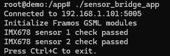
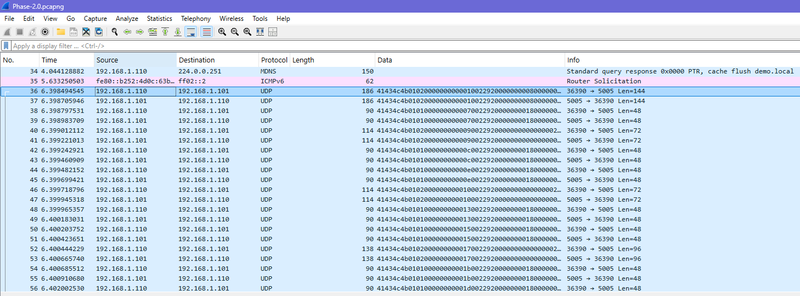
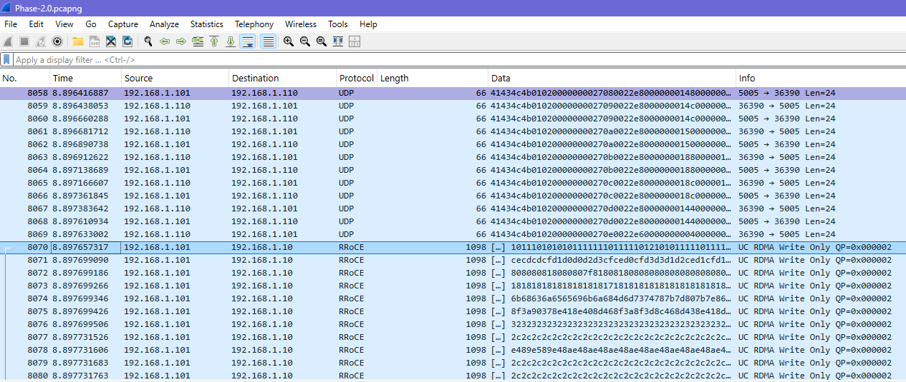

# Getting Started: Execute the Control Plane

This is part 3 of 3 of Getting Started: [Hardware Connection](05-getting-started-1-hardware-connection.md), [Configure the Board](05-getting-started-2-configure-the-board.md), [Execute the Control Plane](05-getting-started-3-execute-the-control-plane.md).

Once the FPGA is programmed with the SOF, execute the control plane program. If using the example you should see (you must clone and compile, on a host machine, the [host-control-library](https://github.com/altera-fpga/host-control-library) repository):

*Figure 15. Altera Control Link Execution.*

After this you must see UDP transaction packets, for example in Wireshark:

*Figure 16. Altera Control Link UDP packets.*

After configuration is done, then you can see the RoCE packets

*Figure 17. Streaming after FPGA configuration.*

---

[← Getting Started: Configure the Board](05-getting-started-2-configure-the-board.md) | [Documentation index](README.md) | [Data Formats →](06-data-formats.md)
