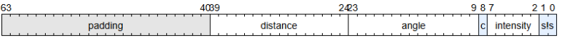
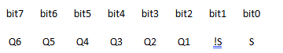

# Data Formats

## Output Data Formats

### General stream characteristics (if configured with default)

- Source IP: 192.168.1.101. Destination IP: 192.168.1.10.
- The luma packets start at 0x00000000 in the Virtual Address field of the RETH/InfiniBand header and end at 0x001FA000.
- The chroma data starts at 0x001FA400 in the Virtual Address field of the RETH/InfiniBand header and ends at 0x002F7400.
- Queue pairs in this release:
    - QP 0x2 (Video)
    - QP 0x3 (Video)
    - QP 0x4 (2D Lidar)
    - QP 0x5 (3D Lidar-Point Cloud)
    - QP 0x6 (3D Lidar-IMU)
    - Note: QP0 and QP1 are reserved in the RoCEv2 protocol: QP0 is the Subnet Management Interface (SMI), and QP1 is the General Service Interface (GSI). Therefore, this release starts with QP2.
- **Important:** For all video, lidar, point-cloud, IMU streams; an Immediate packet marks the end of a frame, field, or reading. It contains a 16-byte payload carrying the 96-bit timestamp. The remaining four bytes are padding.

### Video Stream Characteristics

- The design uses two video generators configured for YUV 4:2:0. A chroma re-packer converts the output to the agreed NV12-like video stream.
    - Video Stream 0: Framos IMX678C (with or without GMSL module) or Colour bar pattern
    - Video Stream 1: Framos IMX678C or Green Screen
- The frame rate is 30 FPS, and the image resolution is 1920 × 1080 pixels.
- Each frame contains 2,025 luma packets using a 1kB MTU.
- Each frame contains 1,036,800 bytes of chroma data, equivalent to 1,012.5 1-kB MTU payloads. Packetization should represent the final half-size payload explicitly.

### 2D Lidar Stream Characteristics

- Each lidar reading generates four RoCEv2 packets: three for samples and one Immediate packet for the timestamp.
- MTU is 1kB.
- Each lidar reading consists of 363 lidar points, with each point occupying 8 bytes.
- Each lidar point follows the raw RPLIDAR A1M8 2D laser-scan data format.

    

- The host must apply a light conversion to decode the raw lidar fields, as described below.
- **Byte 0:**

    

- Where:
    - `S = Start flag`
    - `!S = Inverted start flag`
    - `Q = Quality (6 bits)`
- Bytes 1 and 2 contain the angle as a 15-bit fixed-point value and the check bit, which is always 1. To convert the angle from fixed-point to floating-point:
    - `angle_q6 = ((Byte2 << 7) \| (Byte1 >> 1))`
    - Angle in degrees:
    - `angle = angle_q6 / 64.0`
    - (should be represented as float32)
- Bytes 3 and 4 contain the distance as a 16-bit fixed-point value. To convert the distance from fixed-point to floating-point:
    - `distance_q2 = Byte3 \| (Byte4 << 8)`
    - `distance_mm = distance_q2 / 4.0`
    - (should be represented as float32)
- The remaining bytes are padded with 0x00.
- The lidar stream rate is approximately 5.5 Hz, which is close to the sensor's nominal operating rate.

### 3D Lidar Point Cloud Stream Characteristics

- Each 3D lidar Point Cloud reading generates 3 RoCEv2 packets: two for samples and one Immediate packet for the timestamp.
- MTU is 1kB.
- Each lidar reading consists of 96 point-cloud points, with each point occupying 16 bytes (128 bits).
- The first RoCE packet contains 1024 Bytes and the second 512 bytes (a total of 1536 bytes)
- Each 3D lidar point-cloud follows the raw Livox MID-360s Point Cloud data format (plus padding).
- The period is about ~476us (~2.1kHz)

| Bit Range | Field | Data Type | Description |
| --- | --- | --- | --- |
| [31:0] | x | `int32_t` | X axis, Unit: mm |
| [63:32] | y | `int32_t` | Y axis, Unit: mm |
| [95:64] | z | `int32_t` | Z axis, Unit: mm |
| [103:96] | Reflectivity | `Int8_t` | Reflectivity |
| [111:104] | Tag | `Int8_t` | According to the point cloud frame header `pack_info`.`tag_type` field, match the specific tag type. For details, see [2.4 Tag Information](https://livox-wiki-en.readthedocs.io/en/latest/tutorials/new_product/mid360/livox_eth_protocol_mid360.html). |
| [127:112] | Zero Padding | N/A |  |

### 3D Lidar IMU Stream Characteristics

- Each 3D lidar IMU reading generates 2 RoCEv2 packets: ONE for samples and another Immediate packet for the timestamp.
- MTU is 1kB.
- Each IMU reading consists of a single IMU reading (gyro/acceleration), with each point occupying 24 bytes (192 bits).
- Each 3D lidar IMU follows the raw Livox MID-360s IMU data format (plus padding).
- Rate is ~133.33 readings/s (133.33 Hz)

| Bit Range | Field | Data Type | Description |
| --- | --- | --- | --- |
| [31:0] | `gyro_x` | float | Unit: rad/s |
| [63:32] | `gyro_y` | float | Unit: rad/s |
| [95:64] | `gyro_z` | Float | Unit: rad/s |
| [127:96] | `acc_x` | float | Unit: g |
| [159:128] | `acc_y` | float | Unit: g |
| [191:160] | `acc_z` | float | Unit: g |

Note: for more information about the Livox Lidar visit <https://livox-wiki-en.readthedocs.io/en/latest/tutorials/new_product/mid360/livox_eth_protocol_mid360.html>

## Timestamping Format

The end of each video frame, lidar, Point-Cloud or IMU reading is identified by a RoCEv2 Immediate packet containing a 16-byte payload that describes the timestamp of the sensor data. The format follows IEEE 1588.

**00-00-00-00-SS5-SS4- SS3- SS2- SS1-SS0-NN3-NN2-NN1-NN0-FF1-FF0**

| **Field** | **96-bit Timestamp Format** |
| --- | --- |
| Padding (00) | 32 bits |
| Second (SS) | 48 bits |
| Nanosecond (NN) | 32 bits |
| Fractional nanosecond (FF) | 16 bits |

---

[← Getting Started: Execute the Control Plane](05-getting-started-3-execute-the-control-plane.md) | [Documentation index](README.md) | [FPGA System Description →](07-fpga-system-description.md)
