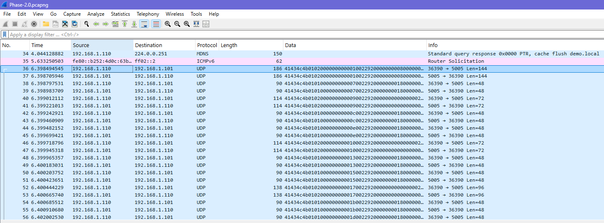
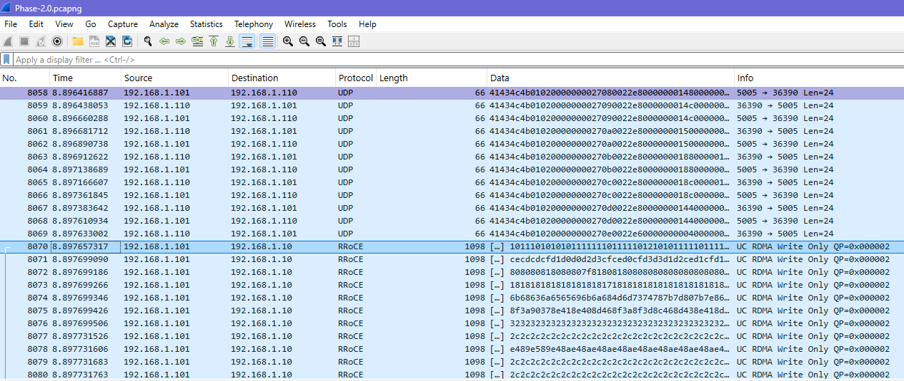

# Getting Started: Execute the Control Plane

This is part 3 of 3 of Getting Started: [Hardware Connection](04-getting-started-1-hardware-connection.md), [Configure the Board](05-getting-started-2-configure-the-board.md), [Execute the Control Plane](06-getting-started-3-execute-the-control-plane.md).

Once the FPGA is programmed with the SOF, run a suitable example application on the host to configure the FPGA and start streaming sensor data.

### Build the Docker image

Before continuing ensure `Docker` is installed and available on your host.

Navigate to the [host-examples](../host-examples) directory and run:

```bash
docker build -t sensor-link-examples .
```

The Docker build creates a runtime image containing all example application executables.

### Run an example

Start the Docker container using host networking so the container can reach the FPGA UDP endpoint:

```bash
docker run --rm --network host sensor-link-examples
```

Once you are inside the Docker container you can run your chosen example application. For example if you programmed one of the `DUAL-CAM_LIDAR2D_LIDAR3D` SOF files run the following example application:

```bash
./mdk_dual_cam_lidar_example
```

Or if you are using a Framos GMSL module connected to MIPI0:

```bash
./mdk_dual_cam_lidar_example --gmsl
```

If you monitor UDP packets with a tool such as Wireshark you should see the UDP control packets being sent on port `5005`.

<p align="center">
  
</p>

<p align="center"><strong>Figure 16. Altera® Host Control UDP packets.</strong></p>

<br>

After the configuration is complete, you will see the RoCEv2 packets, which contain the sensor data, being received by the host.

<p align="center">
  
</p>

<p align="center"><strong>Figure 17. Streaming after FPGA configuration.</strong></p>

<br>

---

[← Getting Started: Configure the Board](05-getting-started-2-configure-the-board.md) | [Documentation index](README.md) | [Data Formats →](07-data-formats.md)
