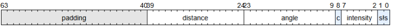
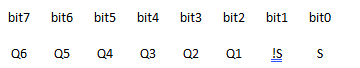

# Data Formats

## Output Data Formats

### General stream characteristics (default configuration)

- Source IP: 192.168.1.101. Destination IP: 192.168.1.10.
- The luma packets start at 0x00000000 in the Virtual Address field of the RETH/InfiniBand header. The last luma packet is at 0x001FA000.
- The chroma data starts at 0x001FA400 in the Virtual Address field of the RETH/InfiniBand header. The last (half-size) chroma packet is at 0x002F7400.
- Queue pairs in this release:
    - QP 0x2 (Video)
    - QP 0x3 (Video)
    - QP 0x4 (2D lidar)
    - QP 0x5 (3D lidar point cloud)
    - QP 0x6 (3D lidar IMU)
    - Note: QP0 and QP1 are reserved in the RoCEv2 protocol: QP0 is the Subnet Management Interface (SMI), and QP1 is the General Service Interface (GSI). Therefore, this release starts with QP 0x2.
- **Important:** For all video, lidar, point-cloud, and IMU streams, an Immediate packet marks the end of a frame or reading. It contains a 16-byte payload that carries the 96-bit timestamp. The remaining four bytes are padding.

### Video Stream Characteristics

- The design uses two video sources configured for YUV 4:2:0. A chroma repacker converts the output to an NV12-like format.
    - Video stream 0: Framos IMX678C (with or without GMSL module) or color bar pattern
    - Video stream 1: Framos IMX678C or green screen
- The frame rate is 30 FPS, and the image resolution is 1920 × 1080 pixels.
- Each frame contains 2,025 luma packets using a 1 kB MTU.
- Each frame contains 1,036,800 bytes of chroma data, equivalent to 1,012.5 payloads of 1 kB. The last chroma packet of each frame is therefore half size (512 bytes).

### 2D Lidar Stream Characteristics

- Each lidar reading generates four RoCEv2 packets: three for samples and one Immediate packet for the timestamp.
- MTU is 1 kB.
- Each lidar reading consists of 363 lidar points, with each point occupying 8 bytes.
- Each lidar point follows the raw RPLIDAR A1M8 2D laser-scan data format.

    

      
    

- The host must apply a light conversion to decode the raw lidar fields, as described below.
- **Byte 0:**

    

      
    

- Where:
    - `S = Start flag`
    - `!S = Inverted start flag`
    - `Q = Quality (6 bits)`
- Bytes 1 and 2 contain the angle as a 15-bit fixed-point value and the check bit, which is always 1. To convert the angle from fixed-point to floating-point:
    - `angle_q6 = ((Byte2 << 7) | (Byte1 >> 1))`
    - Angle in degrees:
    - `angle = angle_q6 / 64.0`
    - (should be represented as float32)
- Bytes 3 and 4 contain the distance as a 16-bit fixed-point value. To convert the distance from fixed-point to floating-point:
    - `distance_q2 = Byte3 | (Byte4 << 8)`
    - `distance_mm = distance_q2 / 4.0`
    - (should be represented as float32)
- The remaining bytes are padded with 0x00.
- The lidar stream rate is approximately 5.5 Hz, which is close to the sensor's nominal operating rate.

### 3D Lidar Point Cloud Stream Characteristics

- Each 3D lidar point-cloud reading generates three RoCEv2 packets: two for samples and one Immediate packet for the timestamp.
- MTU is 1 kB.
- Each lidar reading consists of 96 point-cloud points, with each point occupying 16 bytes (128 bits).
- The first RoCEv2 packet contains 1024 bytes and the second contains 512 bytes (1536 bytes in total).
- Each 3D lidar point-cloud reading follows the raw Livox MID-360S point cloud data format (plus padding).
- The period is about 476 µs (about 2.1 kHz).

<table align="center">
  <thead>
    <tr><th>Bit Range</th><th>Field</th><th>Data Type</th><th>Description</th></tr>
  </thead>
  <tbody>
    <tr><td>[31:0]</td><td>x</td><td><code>int32_t</code></td><td>X axis, Unit: mm</td></tr>
    <tr><td>[63:32]</td><td>y</td><td><code>int32_t</code></td><td>Y axis, Unit: mm</td></tr>
    <tr><td>[95:64]</td><td>z</td><td><code>int32_t</code></td><td>Z axis, Unit: mm</td></tr>
    <tr><td>[103:96]</td><td>Reflectivity</td><td><code>uint8_t</code></td><td>Reflectivity</td></tr>
    <tr><td>[111:104]</td><td>Tag</td><td><code>uint8_t</code></td><td>According to the point cloud frame header <code>pack_info</code>.<code>tag_type</code> field, match the specific tag type. For details, see <a href="https://livox-wiki-en.readthedocs.io/en/latest/tutorials/new_product/mid360/livox_eth_protocol_mid360.html">2.4 Tag Information</a>.</td></tr>
    <tr><td>[127:112]</td><td>Zero Padding</td><td>N/A</td><td></td></tr>
  </tbody>
</table>

 

### 3D Lidar IMU Stream Characteristics

- Each 3D lidar IMU reading generates two RoCEv2 packets: one for the sample and one Immediate packet for the timestamp.
- MTU is 1 kB.
- Each IMU reading is a single gyroscope and accelerometer sample that occupies 24 bytes (192 bits).
- Each 3D lidar IMU reading follows the raw Livox MID-360S IMU data format (plus padding).
- The rate is about 133.33 readings per second (133.33 Hz).

<table align="center">
  <thead>
    <tr><th>Bit Range</th><th>Field</th><th>Data Type</th><th>Description</th></tr>
  </thead>
  <tbody>
    <tr><td>[31:0]</td><td><code>gyro_x</code></td><td>float</td><td>Unit: rad/s</td></tr>
    <tr><td>[63:32]</td><td><code>gyro_y</code></td><td>float</td><td>Unit: rad/s</td></tr>
    <tr><td>[95:64]</td><td><code>gyro_z</code></td><td>float</td><td>Unit: rad/s</td></tr>
    <tr><td>[127:96]</td><td><code>acc_x</code></td><td>float</td><td>Unit: g</td></tr>
    <tr><td>[159:128]</td><td><code>acc_y</code></td><td>float</td><td>Unit: g</td></tr>
    <tr><td>[191:160]</td><td><code>acc_z</code></td><td>float</td><td>Unit: g</td></tr>
  </tbody>
</table>

 

For more information about the Livox MID-360S, see the [Livox MID-360 communication protocol](https://livox-wiki-en.readthedocs.io/en/latest/tutorials/new_product/mid360/livox_eth_protocol_mid360.html).

## Timestamping Format

The end of each video frame and each lidar, point-cloud, or IMU reading is identified by a RoCEv2 Immediate packet. Its 16-byte payload carries the timestamp of the sensor data in an IEEE 1588 based format:

**00-00-00-00-SS5-SS4-SS3-SS2-SS1-SS0-NN3-NN2-NN1-NN0-FF1-FF0**

<table align="center">
  <thead>
    <tr><th>Field</th><th>Width</th></tr>
  </thead>
  <tbody>
    <tr><td>Padding (00)</td><td>32 bits</td></tr>
    <tr><td>Seconds (SS)</td><td>48 bits</td></tr>
    <tr><td>Nanosecond (NN)</td><td>32 bits</td></tr>
    <tr><td>Fractional nanosecond (FF)</td><td>16 bits</td></tr>
  </tbody>
</table>

 

---

[← Getting Started: Execute the Control Plane](06-getting-started-3-execute-the-control-plane.md) | [Documentation index](README.md) | [FPGA System Description →](08-fpga-system-description.md)
