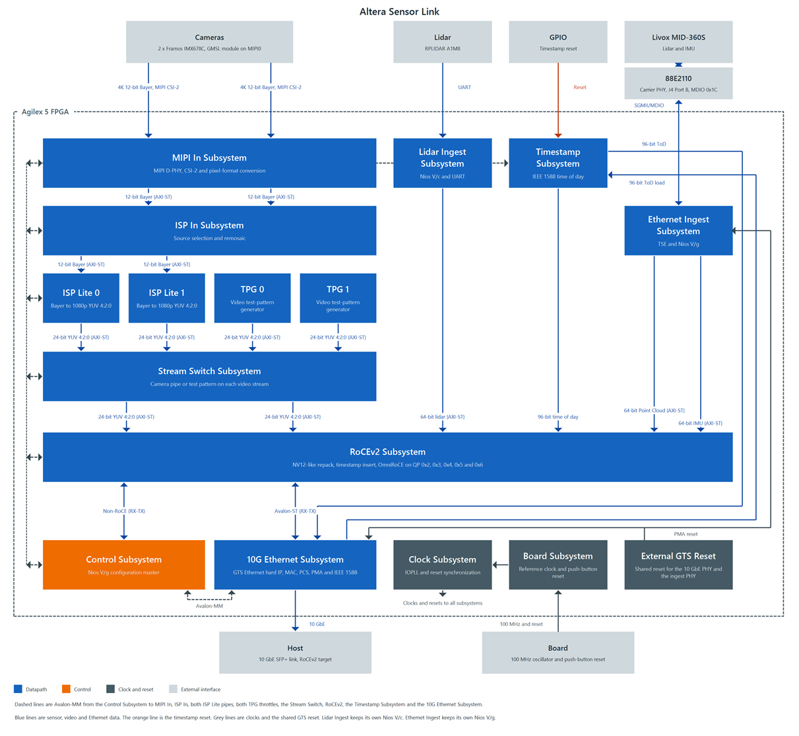

# FPGA System Description

The design is implemented as the Quartus Prime project top-level design, built in Platform Designer and/or Visual Designer Studio, on the Agilex™ 5 devices A5ED065BB32AE6SR0 and A5ED065BB32AE4S. The FPGA is partitioned into the Platform Designer and/or Visual Designer Studio subsystems shown in Figure 18. Each box in the figure is one subsystem in that project. Clock and reset trees are shown at a high level; the IP inside each subsystem is described on the subsystem pages listed in the table below.

The video path starts with two IMX678C camera inputs. The MIPI In Subsystem recovers the CSI-2 links and presents two 12-bit Bayer AXI4-Stream interfaces to the ISP In Subsystem. ISP In performs source selection and remosaic, then feeds two parallel ISP Lite pipes that convert 4K 12-bit Bayer video to 1080p, 30 FPS, 8-bit YUV 4:2:0. Two VVP test-pattern generators provide synthetic video of the same format. The Stream Switch Subsystem selects, for each of the two video streams, either the corresponding ISP Lite pipe or the corresponding test-pattern generator. The selected streams leave the switch as 24-bit YUV 4:2:0 AXI4-Stream and enter the RoCEv2 Subsystem.

The lidar path is independent of the video pipeline. The Lidar Ingest Subsystem captures the RPLIDAR A1M8 over UART and forwards the raw scan data as a 64-bit AXI4-Stream into the RoCEv2 Subsystem. The Ethernet Ingest Subsystem brings in a Livox MID-360S through SGMII/MDIO and the carrier 88E2110 on J4 Port B, and forwards two raw 64-bit streams, the point cloud and the IMU, into the RoCEv2 Subsystem. The Timestamp Subsystem maintains an IEEE 1588 96-bit time of day, which can optionally be reset from a GPIO input (not used when PTP is enabled). It supplies that timestamp to the RoCEv2 Subsystem so that each video frame, lidar reading, and Ethernet ingest stream can be marked on the wire. It also broadcasts the 96-bit time of day to the 10G Ethernet MAC on one Avalon-ST connection and receives the time-of-day load on a second Avalon-ST connection.

Inside the RoCEv2 Subsystem the video streams are chroma-repacked from YUV 4:2:0 to the NV12-like format used on Ethernet, each stream is bridged onto a RoCEv2 queue pair, and the timestamp is inserted. Queue pairs 0x2 and 0x3 carry the two video streams, queue pair 0x4 carries the RPLIDAR stream, queue pair 0x5 carries the Livox MID-360S point cloud, and queue pair 0x6 carries the IMU from that same lidar. The point cloud and the IMU stay raw. The resulting RoCEv2 packets are handed to the 10G Ethernet Subsystem, which implements the GTS Ethernet hard IP, and leave the board on the SFP+ link to the host. One external GTS reset sequencer is shared by that 10G MAC and the Ethernet ingest PHY.

The Control Subsystem is a processor-based subsystem that configures the other subsystems over an Avalon-MM interconnect. It also exchanges non-RoCEv2 Ethernet traffic with the RoCEv2 Subsystem in both directions, using mSGDMA transmit and receive channels. The Board Subsystem brings in the 100 MHz oscillator and the push-button reset. The Clock Subsystem multiplies that reference through an IOPLL and distributes clocks and resets to every subsystem: 100 MHz for CSR and CPU domains, including the Ethernet Ingest Nios V/g, 297 MHz for MIPI and ISP video, 148.5 MHz for the VVP AXI4-Stream fabric and the Ethernet Ingest main clock, 125 MHz shared by the lidar UART and Ethernet Ingest TX/RX, 62.5 MHz for the Ethernet Ingest PCS, and the Ethernet interface clock from the GTS hard IP.

  

<strong>Figure 18. Altera® Sensor Link - FPGA subsystem block diagram.</strong>

 

The following table lists the subsystems in Figure 18 and their roles.

<table align="center">
  <thead>
    <tr><th>Subsystem</th><th>Role</th></tr>
  </thead>
  <tbody>
    <tr><td><a href="subsystems/01-mipi-in-subsystem.md">MIPI In Subsystem</a></td><td>MIPI D-PHY, dual CSI-2, pixel-format conversion, camera and board I2C</td></tr>
    <tr><td><a href="subsystems/02-isp-in-subsystem.md">ISP In Subsystem</a></td><td>Bayer source selection and remosaic</td></tr>
    <tr><td><a href="subsystems/03-isp-lite-pipe-0.md">ISP Lite Pipe 0</a></td><td>4K 12-bit Bayer to 1080p 8-bit YUV 4:2:0</td></tr>
    <tr><td><a href="subsystems/04-isp-lite-pipe-1.md">ISP Lite Pipe 1</a></td><td>4K 12-bit Bayer to 1080p 8-bit YUV 4:2:0</td></tr>
    <tr><td><a href="subsystems/05-video-tpg-0.md">Video TPG 0</a></td><td>Synthetic video source</td></tr>
    <tr><td><a href="subsystems/06-video-tpg-1.md">Video TPG 1</a></td><td>Synthetic video source</td></tr>
    <tr><td><a href="subsystems/07-stream-switch-subsystem.md">Stream Switch Subsystem</a></td><td>Selects ISP Lite or TPG for each of the two video streams</td></tr>
    <tr><td><a href="subsystems/08-lidar-ingest-subsystem.md">Lidar Ingest Subsystem</a></td><td>Nios V UART capture and raw lidar streaming</td></tr>
    <tr><td><a href="subsystems/09-ethernet-ingest-subsystem.md">Ethernet Ingest Subsystem</a></td><td>TSE and Nios V/g; raw Livox point cloud and IMU</td></tr>
    <tr><td><a href="subsystems/10-external-gts-reset.md">External GTS Reset</a></td><td>Shared PMA reset for the 10G MAC and the Ethernet Ingest PHY</td></tr>
    <tr><td><a href="subsystems/11-timestamp-subsystem.md">Timestamp Subsystem</a></td><td>IEEE 1588 96-bit time of day, external reset, and broadcast to the 10G MAC</td></tr>
    <tr><td><a href="subsystems/12-rocev2-subsystem.md">RoCEv2 Subsystem</a></td><td>Five-channel Altera® Sensor Link Stream Multiplexer, chroma repack, and RoCEv2 transmit</td></tr>
    <tr><td><a href="subsystems/13-10g-ethernet-subsystem.md">10G Ethernet Subsystem</a></td><td>GTS Ethernet hard IP, MAC, PCS, PMA, and IEEE 1588</td></tr>
    <tr><td><a href="subsystems/14-control-subsystem.md">Control Subsystem</a></td><td>Nios V configuration master and non-RoCEv2 TX/RX</td></tr>
    <tr><td>Clock Subsystem</td><td>IOPLL and per-domain reset synchronization</td></tr>
    <tr><td>Board Subsystem</td><td>Board clock bridge and push-button reset</td></tr>
  </tbody>
</table>

 

---

[← Data Formats](07-data-formats.md) | [Documentation index](README.md) | [MIPI In Subsystem →](subsystems/01-mipi-in-subsystem.md)
