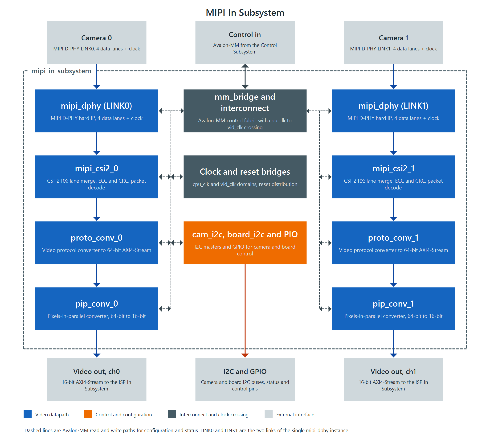

# MIPI In Subsystem

The MIPI In Subsystem terminates the two camera links and presents a 16-bit Bayer stream to each input of the ISP In Subsystem. One MIPI D-PHY hard IP recovers both links. LINK0 and LINK1 on the figure are the two links of that single PHY. Each link then has its own MIPI CSI-2 receiver, a Protocol Converter, and a Pixels in Parallel Converter.

Camera and board I2C, and the mode PIOs, sit on the same Avalon-MM fabric as the video IP. The Control Subsystem uses that fabric for configuration and status. Dashed lines on the figure are Avalon-MM read and write paths.

**IP in this subsystem**

| IP | Function |
| --- | --- |
| MIPI D-PHY | Recovers the serial camera links. Both cameras use this one dual-link PHY, four data lanes and a clock each. |
| MIPI CSI-2 | One receiver per link. It merges the lanes, checks ECC and CRC, and decodes the CSI-2 packets. |
| Protocol Converter | Puts each CSI-2 stream onto the Altera Streaming Video protocol used by the Video and Vision Processing IP. On the figure this is the 64-bit AXI4-Stream stage. |
| Pixels in Parallel Converter | Changes how many pixels are carried in one beat. On the figure this narrows the 64-bit stream to the 16-bit Bayer output. |
| Avalon I2C (Master) | Two masters, one for the camera bus and one for the board bus. |
| PIO | Parallel I/O for camera and board status and control pins. |

*Figure 19. MIPI In Subsystem block diagram.*

---

[← FPGA System Description](../07-fpga-system-description.md) | [Documentation index](../README.md) | [ISP In Subsystem →](02-isp-in-subsystem.md)
