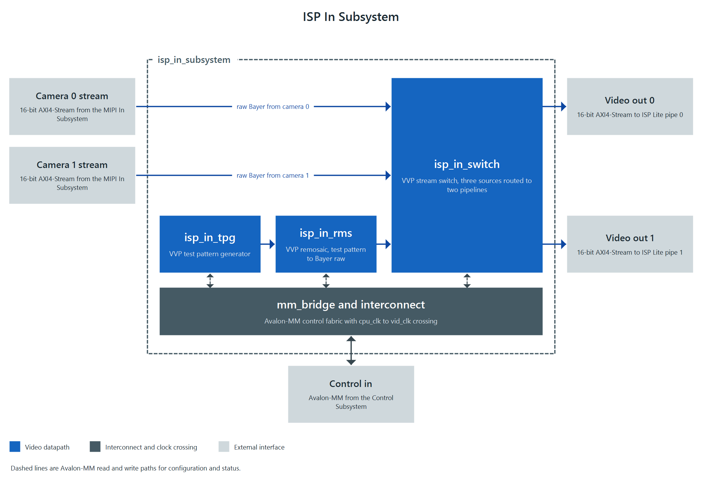

# ISP In Subsystem

The ISP In Subsystem chooses the Bayer source for the two ISP Lite pipes. The live inputs are the two 16-bit Bayer streams from the MIPI In Subsystem. The Switch IP routes three sources onto the two pipe inputs.

The third source is internal. The Test-Pattern Generator produces a video field without a camera, and the Remosaic IP converts that RGB image to a 2x2 Bayer stream so it matches the camera format. All three blocks are configured over Avalon-MM.

**IP in this subsystem**

| IP | Function |
| --- | --- |
| Test-Pattern Generator | Produces one fixed test image per field, on request, so the ISP path can be exercised without a camera. Resolution, colour space and pattern are runtime settings. |
| Remosaic | Converts the test-pattern RGB image to 2x2 Bayer, which is the format the ISP Lite pipes expect from a camera. |
| Switch | Crosspoint for the two camera streams and the remosaiced test pattern. Each of the two outputs is sent to one ISP Lite pipe. |

*Figure 20. ISP In Subsystem block diagram.*

---

[← MIPI In Subsystem](01-mipi-in-subsystem.md) | [Documentation index](../README.md) | [ISP Lite Pipe 0 →](03-isp-lite-pipe-0.md)
