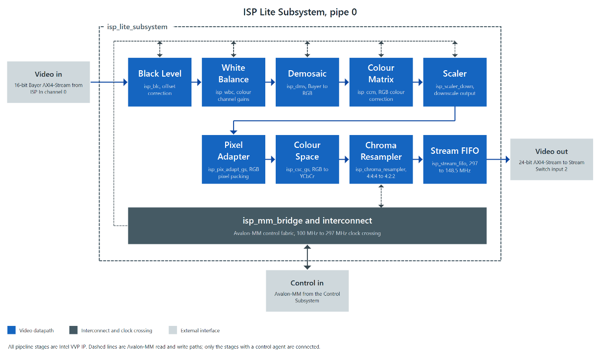

# ISP Lite Pipe 0

ISP Lite Pipe 0 processes channel 0 from the ISP In Subsystem and drives Stream Switch input 2. The processing stages run at 297 MHz. The Video Streaming FIFO then crosses the stream into the 148.5 MHz domain. The Avalon-MM fabric crosses from the 100 MHz control clock.

The functions below are the roles of these Video and Vision Processing Suite IP blocks in this pipe. Black-level correction, white balance, demosaic, the colour-matrix converter, the scaler and the chroma resampler have control agents. The bits-per-sample adapter, the RGB-to-YCbCr converter and the stream FIFO do not. Register addresses are in [Appendix A](../appendix-a-control-memory-map.md).

IP in this subsystem

| IP | Function |
| --- | --- |
| Black Level Correction | Subtracts the sensor pedestal from a 2x2 Bayer image and stretches the result back across the full sample range, so the darkest code represents black. |
| White Balance Correction | Applies per-channel gains on the 2x2 Bayer image so a white object is not tinted by the illuminant or by the colour-filter response. |
| Demosaic | Reconstructs an RGB sample at every pixel by interpolating the missing colours from the Bayer neighbours. |
| Color Space Converter (colour matrix) | `isp_ccm`. A Color Space Converter used as the RGB colour-correction matrix. Coefficients can be changed at run time. |
| Scaler | Resizes the field. In this pipe it is the downscale stage, `isp_scaler_down`. Input size for the lite protocol is set through the register map. |
| Bits per Color Sample Adapter | Matches the number of bits in each colour sample between the scaler and the following converter. Narrower outputs drop least-significant bits; wider outputs pad zeros. |
| Color Space Converter (RGB to YCbCr) | `isp_csc_gs`. Transforms the RGB samples into YCbCr for the chroma resampler. This instance has no control agent. |
| Chroma Resampler | Changes YCbCr chroma sampling. The IP supports 4:4:4, 4:2:2 and 4:2:0. On the figure this stage is 4:4:4 to 4:2:2. |
| Video Streaming FIFO | Buffers the stream and crosses it from 297 MHz to 148.5 MHz. It holds the input when full so samples are not dropped. |

*Figure 21. ISP Lite Pipe 0 block diagram.*

---

[← ISP In Subsystem](02-isp-in-subsystem.md) | [Documentation index](../README.md) | [ISP Lite Pipe 1 →](04-isp-lite-pipe-1.md)
