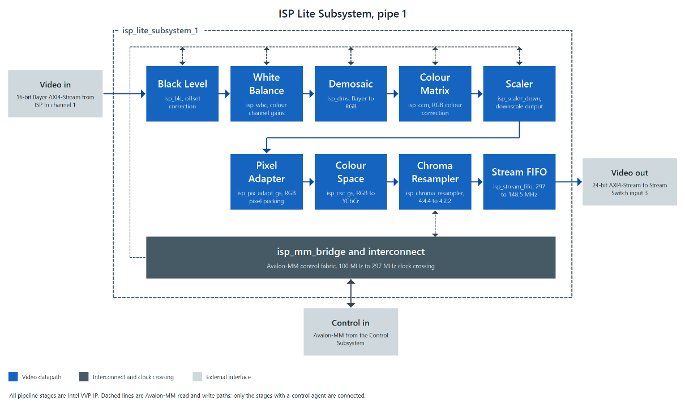

# ISP Lite Pipe 1

ISP Lite Pipe 1 is the same chain for channel 1, in `isp_lite_subsystem_1`. Its output feeds Stream Switch input 3. Clocking matches Pipe 0: 297 MHz through the processing stages, then 148.5 MHz after the stream FIFO.

The IP and the order are the same as Pipe 0, with a separate Avalon-MM register space so the two pipes are programmed independently. See [Appendix A](../appendix-a-control-memory-map.md) for the Pipe 1 base addresses.

IP in this subsystem

| IP | Function |
| --- | --- |
| Black Level Correction | Same function as Pipe 0, on channel 1. |
| White Balance Correction | Same function as Pipe 0, on channel 1. |
| Demosaic | Same function as Pipe 0, on channel 1. |
| Color Space Converter (colour matrix) | Same function as Pipe 0, with its own coefficients. |
| Scaler | Same function as Pipe 0, with its own output size. |
| Bits per Color Sample Adapter | Same function as Pipe 0. No control agent. |
| Color Space Converter (RGB to YCbCr) | Same function as Pipe 0. No control agent. |
| Chroma Resampler | Same function as Pipe 0, with its own sampling settings. |
| Video Streaming FIFO | Same 297 MHz to 148.5 MHz crossing as Pipe 0. |

*Figure 22. ISP Lite Pipe 1 block diagram.*

---

[← ISP Lite Pipe 0](03-isp-lite-pipe-0.md) | [Documentation index](../README.md) | [Video TPG 0 →](05-video-tpg-0.md)
