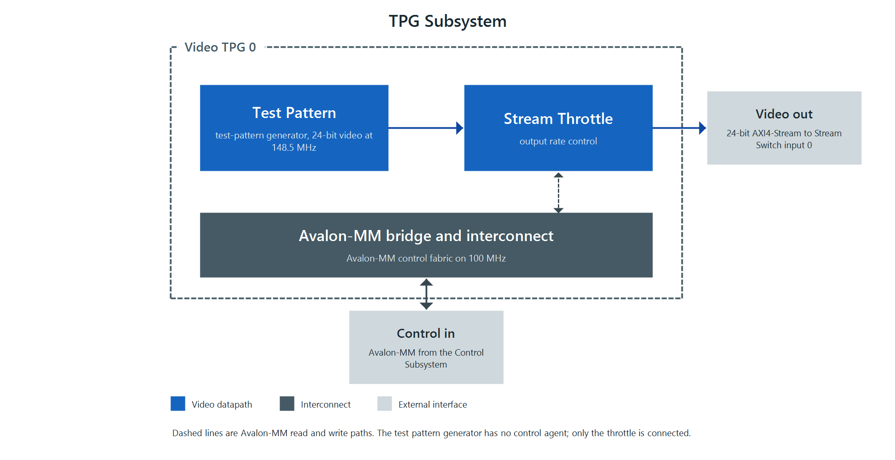

# Video TPG 0

Video TPG 0 is the synthetic source for Stream Switch input 0. It runs at 148.5 MHz and produces a 24-bit stream. The generator itself has no Avalon-MM agent. Only the Video Rate Control block is connected to the 100 MHz control fabric.

**IP in this subsystem**

<table align="center">
  <thead>
    <tr><th>IP</th><th>Function</th></tr>
  </thead>
  <tbody>
    <tr><td>Test-Pattern Generator</td><td>Produces one fixed test image per field, on request, so the switch and RoCEv2 path can be checked without a camera.</td></tr>
    <tr><td>Video Rate Control</td><td>Throttles the generator output to the rate required downstream. This is the only control agent in the subsystem.</td></tr>
  </tbody>
</table>

 

  

<strong>Figure 23. Video TPG 0 block diagram.</strong>

 

---

[← ISP Lite Pipe 1](04-isp-lite-pipe-1.md) | [Documentation index](../README.md) | [Video TPG 1 →](06-video-tpg-1.md)
