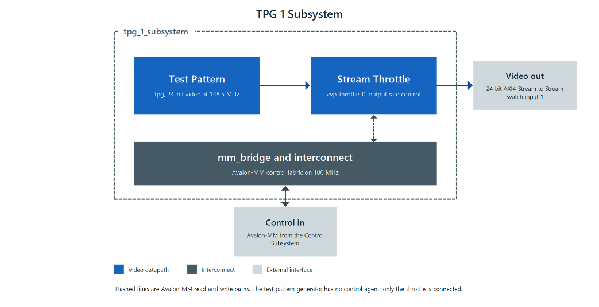

# Video TPG 1

Video TPG 1 is the synthetic source for Stream Switch input 1. The IP is the same as Video TPG 0, in `tpg_1_subsystem`, with its own throttle registers.

**IP in this subsystem**

| IP | Function |
| --- | --- |
| Test-Pattern Generator | Same function as Video TPG 0. No control agent. |
| Video Rate Control | Same throttle function as Video TPG 0, with its own Avalon-MM agent. |

*Figure 24. Video TPG 1 block diagram.*

---

[← Video TPG 0](05-video-tpg-0.md) | [Documentation index](../README.md) | [Stream Switch Subsystem →](07-stream-switch-subsystem.md)
