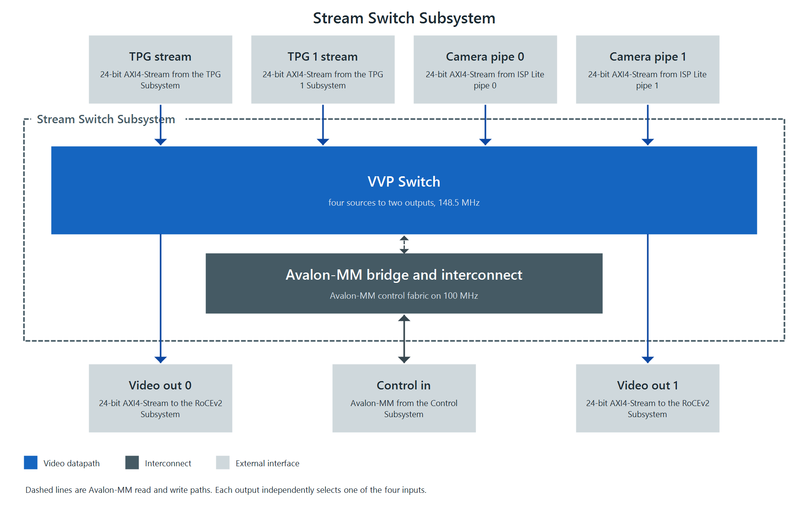

# Stream Switch Subsystem

The Stream Switch Subsystem takes four 148.5 MHz streams: Video TPG 0, Video TPG 1, ISP Lite Pipe 0 and ISP Lite Pipe 1. It drives the two video inputs of the RoCEv2 Subsystem. Selection is programmed over Avalon-MM at 100 MHz.

**IP in this subsystem**

<table align="center">
  <thead>
    <tr><th>IP</th><th>Function</th></tr>
  </thead>
  <tbody>
    <tr><td>Switch</td><td>Crosspoint from four inputs to two outputs. Input 0 is Video TPG 0, input 1 is Video TPG 1, input 2 is ISP Lite Pipe 0 and input 3 is ISP Lite Pipe 1. Each output selects one input. The host consumes inputs 0 and 1, enables inputs 2 and 3, routes input 2 to output 0 and input 3 to output 1, then commits the new selection.</td></tr>
  </tbody>
</table>

 

  

<strong>Figure 25. Stream Switch Subsystem block diagram.</strong>

 

---

[← Video TPG 1](06-video-tpg-1.md) | [Documentation index](../README.md) | [Lidar Ingest Subsystem →](08-lidar-ingest-subsystem.md)
