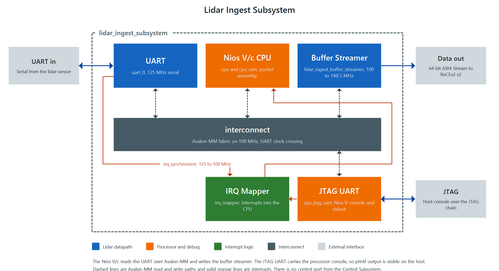

# Lidar Ingest Subsystem

The Lidar Ingest Subsystem is a separate Nios V/c, not the Control Subsystem processor. It reads the lidar UART, assembles packets in on-chip RAM, and writes a buffer streamer. The streamer crosses from 100 MHz to 148.5 MHz and emits a 64-bit AXI4-Stream to the RoCEv2 Subsystem.

The JTAG UART is the processor console, so printf output is visible on the host. Orange lines on the figure are interrupts. The UART interrupt crosses from 125 MHz to 100 MHz. There is no Avalon-MM port from the Control Subsystem.

**IP in this subsystem**

| IP | Function |
| --- | --- |
| Nios V/c | The lidar processor. It reads the UART and writes the buffer streamer. |
| 16550 Compatible UART | Receives the lidar serial stream. The UART clock on the figure is 125 MHz. |
| On-Chip Memory | Working RAM for the lidar processor and for packet assembly. |
| Buffer Streamer | Takes the assembled lidar data and emits the 64-bit stream toward RoCEv2, crossing from 100 MHz to 148.5 MHz. |
| JTAG UART | Host console for the lidar processor. |

*Figure 26. Lidar Ingest Subsystem block diagram.*

---

[← Stream Switch Subsystem](07-stream-switch-subsystem.md) | [Documentation index](../README.md) | [Ethernet Ingest Subsystem →](09-ethernet-ingest-subsystem.md)
