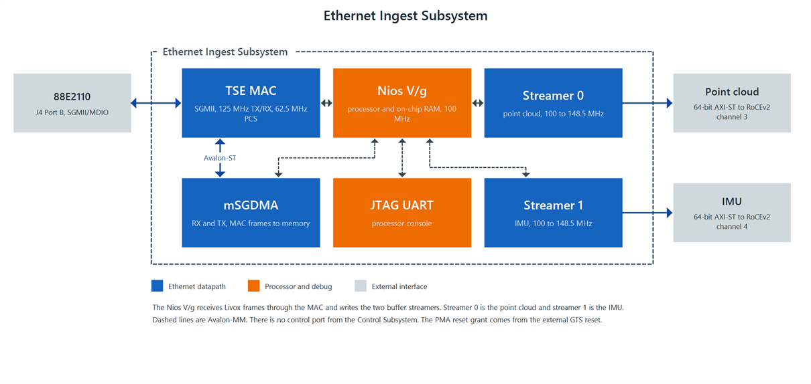

# Ethernet Ingest Subsystem

The Ethernet Ingest Subsystem is a Nios V/g-based subsystem. It connects to a Livox MID-360S through SGMII/MDIO and the carrier 88E2110 on J4 Port B (Lower). The Triple-Speed Ethernet MAC receives the sensor frames, and the processor writes two buffer streamers. Streamer 0 forwards the raw 64-bit point cloud to RoCEv2 channel 3, queue pair 0x5. Streamer 1 forwards the raw 64-bit IMU to RoCEv2 channel 4, queue pair 0x6.

Both streamers cross from 100 MHz to 148.5 MHz. The MAC TX/RX clock is 125 MHz and the PCS clock is 62.5 MHz. The processor runs at 100 MHz. The JTAG UART is a processor console. There is no Avalon-MM port from the Control Subsystem. The PMA reset grant comes from the external GTS reset.

**IP in this subsystem**

<table align="center">
  <thead>
    <tr><th>IP</th><th>Function</th></tr>
  </thead>
  <tbody>
    <tr><td>Nios V/g</td><td>The Ethernet Ingest processor at 100 MHz. It receives the Livox packets and writes the two buffer streamers.</td></tr>
    <tr><td>Triple-Speed Ethernet MAC</td><td>SGMII/MDIO to the 88E2110 on J4 Port B. The TX/RX clock is 125 MHz and the PCS clock is 62.5 MHz.</td></tr>
    <tr><td>mSGDMA</td><td>RX and TX paths between the MAC and memory, clocked at 100 MHz.</td></tr>
    <tr><td>Buffer Streamer 0</td><td>Raw 64-bit point cloud to RoCEv2 channel 3, queue pair 0x5. Crosses from 100 MHz to 148.5 MHz.</td></tr>
    <tr><td>Buffer Streamer 1</td><td>Raw 64-bit IMU to RoCEv2 channel 4, queue pair 0x6. Crosses from 100 MHz to 148.5 MHz.</td></tr>
    <tr><td>JTAG UART</td><td>Host console for the Ethernet Ingest processor.</td></tr>
  </tbody>
</table>

 

  

<strong>Figure 27. Ethernet Ingest Subsystem block diagram.</strong>

 

---

[← Lidar Ingest Subsystem](08-lidar-ingest-subsystem.md) | [Documentation index](../README.md) | [External GTS Reset →](10-external-gts-reset.md)
