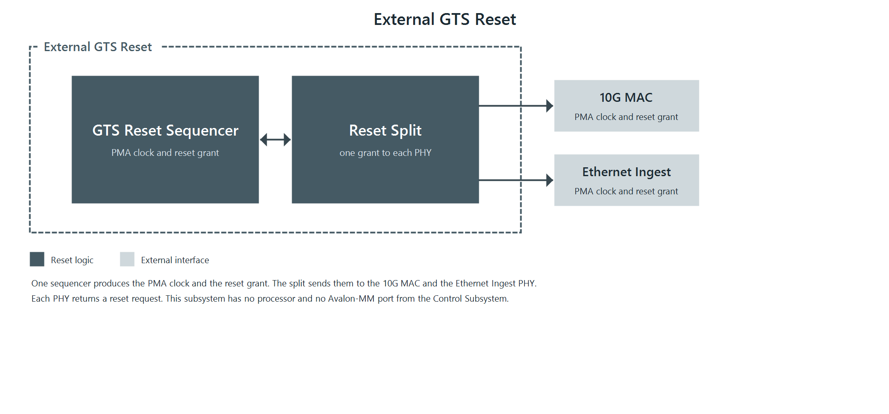

# External GTS Reset

The External GTS Reset subsystem is the reset sequencer shared by the two Ethernet PHYs. The GTS Reset Sequencer produces the PMA clock and the reset grant. The reset split sends that grant to the 10G Ethernet MAC and to the Ethernet Ingest PHY. Each PHY returns a reset request. This subsystem has no processor and is not on the Control memory map.

**IP in this subsystem**

<table align="center">
  <thead>
    <tr><th>IP</th><th>Function</th></tr>
  </thead>
  <tbody>
    <tr><td>GTS Reset Sequencer</td><td>Produces the PMA clock and the reset grant.</td></tr>
    <tr><td>GTS Reset Sequencer Split</td><td>Sends the PMA clock and reset grant to the 10G MAC and the Ethernet Ingest PHY, and returns each PHY's reset request.</td></tr>
  </tbody>
</table>

 

  

<strong>Figure 28. External GTS Reset block diagram.</strong>

 

---

[← Ethernet Ingest Subsystem](09-ethernet-ingest-subsystem.md) | [Documentation index](../README.md) | [Timestamp Subsystem →](11-timestamp-subsystem.md)
