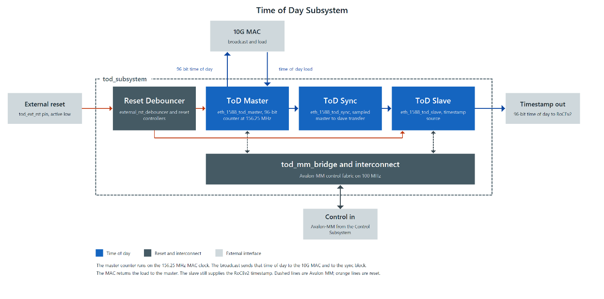

# Timestamp Subsystem

The Timestamp Subsystem keeps the 96-bit time of day used by RoCEv2 and by the 10G MAC. The master counter runs at 156.25 MHz, on the MAC `clk_tx_div`. A broadcast sends that time of day to the 10G MAC and to the synchronizer. The MAC returns the time-of-day load to the master on a second Avalon-ST connection. The synchronizer samples the master count into the slave clock domain, and the slave presents that time to RoCEv2.

An external reset is debounced and applied to the counters (not relevant when running PTP). The master, slave, and sampling clocks are the same 156.25 MHz MAC clock. Solid orange lines on the figure are reset. Dashed lines are Avalon-MM at 100 MHz. The synchronizer and the broadcast have no control agent.

**IP in this subsystem**

| IP | Function |
| --- | --- |
| Ethernet IEEE 1588 Time of Day Clock | Two instances, `eth_1588_tod_master` and `eth_1588_tod_slave`. The master counts at 156.25 MHz on the MAC clock and accepts the time-of-day load from the 10G MAC. The slave holds the sampled value used as the RoCEv2 timestamp. |
| Ethernet IEEE 1588 TOD Broadcast | `eth_1588_tod_broadcast_0`. Sends the master's 96-bit time of day to the 10G MAC and to the synchronizer. |
| Ethernet IEEE 1588 TOD Synchronizer | Samples the master count into the slave clock domain. |
| Reset Debouncer | Cleans the external reset before it is applied to the counters. |

*Figure 29. Timestamp Subsystem block diagram.*

---

[← External GTS Reset](10-external-gts-reset.md) | [Documentation index](../README.md) | [RoCEv2 Subsystem →](12-rocev2-subsystem.md)
