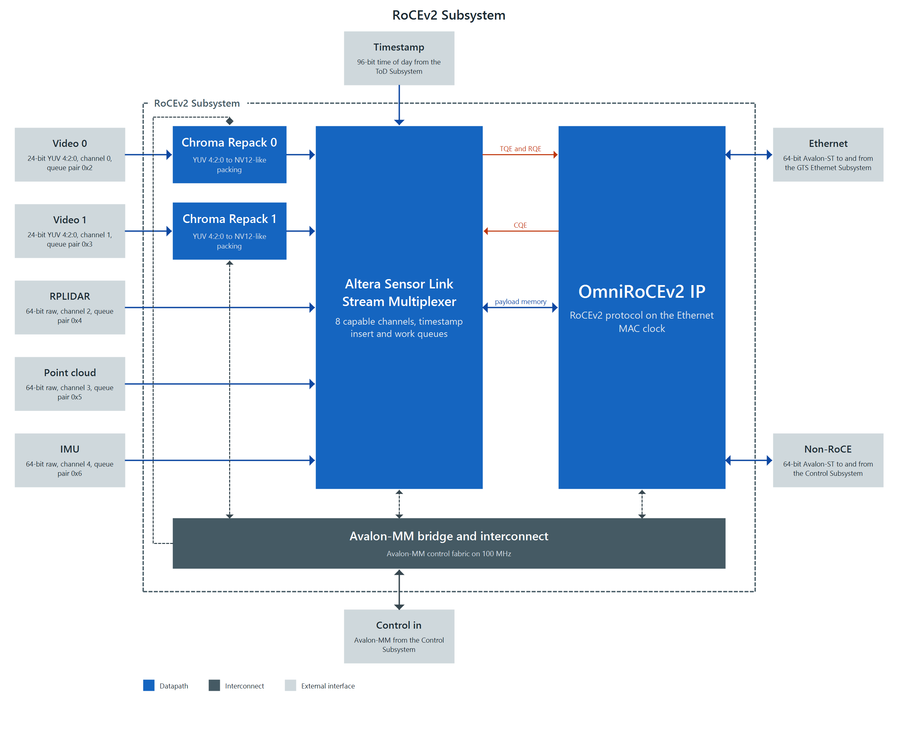

# RoCEv2 Subsystem

The RoCEv2 Subsystem sends five streams to the host over Ethernet. In this particular reference design, channels 0 and 1 are 24-bit video channels on queue pairs 0x2 and 0x3. Channels 2, 3, and 4 are 64-bit raw streams: channel 2 carries the RPLIDAR stream on queue pair 0x4, channel 3 carries the Livox MID-360S point cloud on queue pair 0x5, and channel 4 carries the IMU from that lidar on queue pair 0x6. This reference design uses the Altera® OmniRoCEv2 IP in a lightweight streaming mode: the Altera® Sensor Link Stream Multiplexer (`asl_stream_multiplexer`) and a payload memory sit in front of the IP, and the IP builds and checks the RoCEv2 packets with little work left to the Control Subsystem.

Two 420 Chroma Repack IP instances, one for each video channel, repack the 4:2:0 chroma so that Cb and Cr are interleaved in the same packet. This is essentially an NV12-like format, as shown on the figure. The three raw channels (RPLIDAR, point cloud, and IMU) bypass the chroma repack. The Altera® Sensor Link Stream Multiplexer inserts the 96-bit time of day, posts transmit and receive work-queue entries to the OmniRoCEv2 IP, and holds the payload memory the IP reads and writes. The work-queue entry id is 5 bits wide. The IP returns a completion when that work finishes.

As an initiator, the OmniRoCEv2 IP takes a transmit work-queue entry, reads the payload from local memory, and sends it as one or more Ethernet packets with the InfiniBand transport, IP and UDP headers. When the entry is complete it returns a completion-queue entry. Receive work-queue entries describe buffers for data that arrives from the host. The line interface is 64-bit Avalon-ST to and from the 10G Ethernet Subsystem, on the Ethernet MAC clock.

Packets that are not RoCEv2, such as ARP, ping, and the UDP register-access messages from the host control library on port 5005, are separated onto a second Avalon-ST pair and handled by the Control Subsystem. The bridge and the OmniRoCEv2 IP are configured over Avalon-MM at 100 MHz. Pause, `init_done` and irq are omitted from the figure.

The Altera® Sensor Link Stream Multiplexer register map programs each channel with a type, a line count, a queue pair, Num Buffers, Load Buffer, the remote key and address where the payload is written, a chroma-plane offset, and a separate host address for the timestamp. Channel type 0 is VVP 4:2:0 video and type 1 is a raw stream. By default, one buffer is set on every channel. A line count or chroma offset of zero selects the defaults of 1080 lines and a chroma offset of 1920 x 1080. The multiplexer also measures the video clock and the Ethernet clock against the 100 MHz control clock.

**IP in this subsystem**

<table align="center">
  <thead>
    <tr><th>IP</th><th>Function</th></tr>
  </thead>
  <tbody>
    <tr><td>420 Chroma Repack</td><td>Two instances, one for each video channel. Repacks 4:2:0 chroma so Cb and Cr are interleaved in the same packet. The three raw channels bypass it.</td></tr>
    <tr><td>Altera® Sensor Link Stream Multiplexer (<code>asl_stream_multiplexer</code>)</td><td>Up to 8 channels. Inserts the timestamp, posts transmit and receive work-queue entries, and provides the payload memory. Channels 0 and 1 are 24-bit video. Channels 2, 3, and 4 are 64-bit raw streams in this reference design.</td></tr>
    <tr><td>OmniRoCEv2 IP</td><td>Offloads the RoCEv2 transport and the IP and Ethernet headers between the payload memory and the Ethernet line. Shown as OmniRoCEv2 IP on the figure.</td></tr>
  </tbody>
</table>

 

  

<strong>Figure 30. RoCEv2 Subsystem block diagram.</strong>

 

---

[← Timestamp Subsystem](11-timestamp-subsystem.md) | [Documentation index](../README.md) | [10G Ethernet Subsystem →](13-10g-ethernet-subsystem.md)
