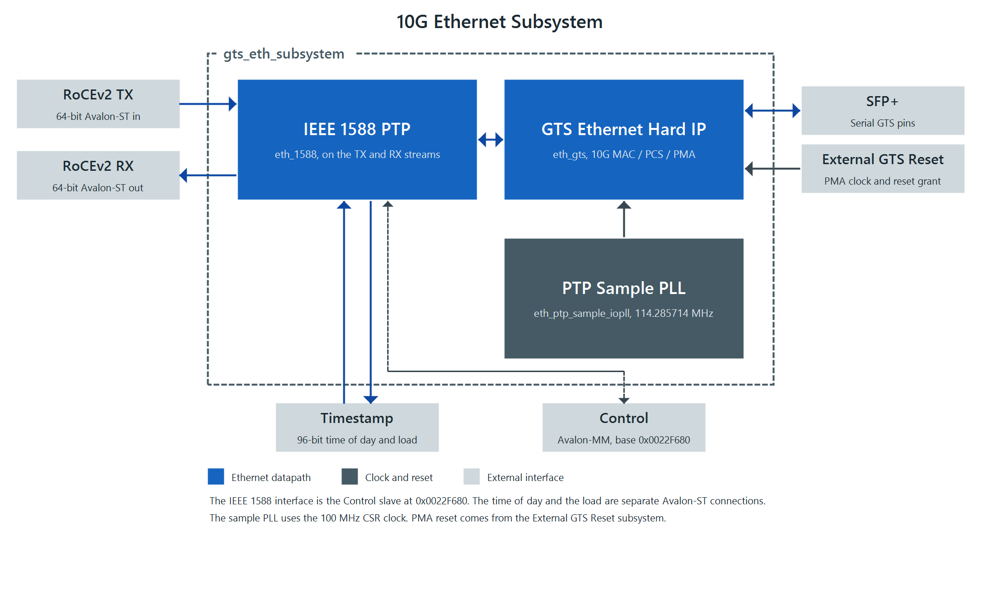

# 10G Ethernet Subsystem

The 10G Ethernet Subsystem is the physical Ethernet port for the RoCEv2 line. Transmit and receive are 64-bit Avalon-ST streams to and from the RoCEv2 Subsystem, and both streams pass through the IEEE 1588 PTP interface. That interface is the Control Subsystem slave at 0x0022F680. It takes the 96-bit time of day from the Timestamp Subsystem and returns the time-of-day load on a second Avalon-ST connection. A PTP sample PLL makes a 114.285714 MHz sample clock for the hard IP from the 100 MHz CSR clock. The Ethernet interface clock generated here is also the RoCEv2 MAC clock and the Control Subsystem Ethernet clock. PMA reset for this MAC comes from the External GTS Reset subsystem, shared with the Ethernet Ingest PHY.

**IP in this subsystem**

| IP | Function |
| --- | --- |
| GTS Ethernet Hard IP | `eth_gts`. 10G MAC, PCS and PMA between the IEEE 1588 interface and the SFP+ serial pins. |
| IEEE 1588 PTP | `eth_1588`. On the transmit and receive streams. Control base 0x0022F680, 128 bytes. Receives the 96-bit time of day and returns the load. |
| PTP Sample PLL | `eth_ptp_sample_iopll`. 100 MHz CSR reference, 114.285714 MHz sample clock to the hard IP. |
| GTS System PLL Clocks | `eth_systemclk_gts`. Produces the transceiver and Ethernet interface clocks for the hard IP. |

*Figure 31. 10G Ethernet Subsystem block diagram.*

---

[← RoCEv2 Subsystem](12-rocev2-subsystem.md) | [Documentation index](../README.md) | [Control Subsystem →](14-control-subsystem.md)
