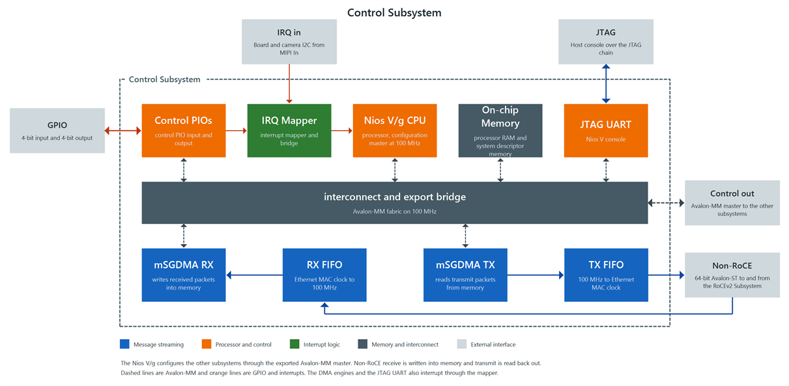

# Control Subsystem

The Control Subsystem is the processor-based system that provides communication between the host and the FPGA, so the host can completely configure all the soft IP in the design. It takes the messages generated by the host running the host control library, which arrive as UDP packets on the non-RoCE Ethernet path, and decodes them into memory-mapped reads and writes. Those accesses control, configure, and change all the registers of the IP that the subsystem is connected to, and the reply goes back to the host over the same path. The subsystem runs at 100 MHz from on-chip memory and reaches every exported slave through the Avalon-MM master shown as Control out.

Non-RoCE Ethernet is a separate path. Receive packets cross from the Ethernet MAC clock into 100 MHz, and a modular scatter-gather DMA writes them into memory. Transmit reads them back out and crosses into the MAC clock. The IRQ bridge collects the input PIO, the external board and camera I2C interrupts, and the DMA interrupts. The JTAG UART and the DMA engines also interrupt through that bridge.

PTP initialization is enabled in this firmware. It runs at startup and programs the IEEE 1588 interface in the 10G Ethernet Subsystem. The cameras, ISP, OmniRoCEv2 IP, and the Altera® Sensor Link Stream Multiplexer are programmed over UDP.

**IP in this subsystem**

<table align="center">
  <thead>
    <tr><th>IP</th><th>Function</th></tr>
  </thead>
  <tbody>
    <tr><td>Nios V/g</td><td>Control processor. Configures the exported slaves in the other subsystems and services non-RoCE Ethernet.</td></tr>
    <tr><td>On-Chip Memory</td><td>Firmware RAM, plus the system-description memory on the same fabric.</td></tr>
    <tr><td>System ID Peripheral</td><td>Read-only system identifier and build timestamp.</td></tr>
    <tr><td>JTAG UART</td><td>Host console for the control processor.</td></tr>
    <tr><td>PIO</td><td>One input PIO and one output PIO, 4 bits each, for board GPIO.</td></tr>
    <tr><td>IRQ Bridge</td><td>Collects local and exported interrupts and presents them to the processor. Shown as the IRQ mapper on the figure.</td></tr>
    <tr><td>Avalon-MM Pipeline Bridge</td><td>The exported master, shown as Control out. This is how the processor reaches the other subsystems.</td></tr>
    <tr><td>Modular Scatter-Gather DMA</td><td>Two engines. One writes received non-RoCE packets into memory. The other reads transmit packets back out.</td></tr>
    <tr><td>Avalon-ST Dual Clock FIFO</td><td>Two FIFOs. One crosses receive traffic from the Ethernet MAC clock to 100 MHz. The other crosses transmit traffic back.</td></tr>
  </tbody>
</table>

 

  

<strong>Figure 32. Control Subsystem block diagram.</strong>

 

---

[← 10G Ethernet Subsystem](13-10g-ethernet-subsystem.md) | [Documentation index](../README.md) | [Altera® Control Link →](../09-altera-control-link.md)
