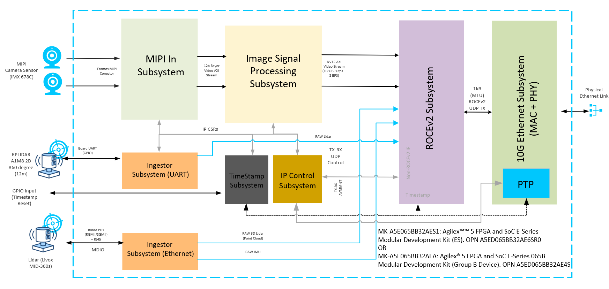

# Altera® Sensor Link

Altera® Sensor Link is an edge platform that brings several sensors into one Agilex™ 5 FPGA and delivers them to a host over a 10 GbE link as separate RoCEv2 streams. Data is tagged with a common IEEE 1588 96-bit timestamp, and a UDP-based library (Altera Control Link) lets the host read and write any IP register in the design.

> This release is a proof of concept. It is not a production-ready solution.

## Hardware

- Agilex 5 FPGA and SoC E-Series Modular Development Kit (ES or 065B production device)
- Two Framos FSM:GO IMX678C camera modules (MIPI0 can use an optional Framos GMSL3 module)
- Slamtec RPLIDAR A1M8 (UART, needs a cable rework and a 5 V supply)
- Livox MID-360S (Ethernet)
- A host with a 10 GbE link

The full list with purchase links is in the [Bill of Materials](Documentation/04-bill-of-materials.md).

## Provided FPGA Binaries (SOF)

- **`M1_CAM_LIDAR2D_LIDAR3D_ES.sof`**: Provides the hardware to configure two cameras over direct MIPI connection and/or one GMSL module connected to the MIPI0 connector. Configuration is chosen by the user using the control interface for configuration. This SOF includes a 2D lidar ingest and a 3D Lidar (Point Cloud + IMU) for the Engineering Sample Board.
- **`M1_CAM_LIDAR2D_LIDAR3D_PROD.sof`**: Provides the hardware to configure two cameras over direct MIPI connection and/or one GMSL module connected to the MIPI0 connector. Configuration is chosen by the user using the control interface for configuration. This SOF includes a 2D lidar ingest and a 3D Lidar (Point Cloud + IMU) for the Production Board.

## Altera Host Control Library

The Altera Host Control Library is published in its own repository: [altera-fpga/host-control-library](https://github.com/altera-fpga/host-control-library). Use a version compatible with the hardware implemented by the SOFs listed above. It serves as the base layer for initializing and configuring the FPGA IP exposed through the control plane.

## Quick start

1. Wire the sensors as described in [Getting Started: Hardware Connection](Documentation/05-getting-started-1-hardware-connection.md).
2. Run PTP on the host as a master. The FPGA PTP engine supports secondary mode only. See [Run PTP in the host interface](Documentation/05-getting-started-2-configure-the-board.md#run-ptp-in-the-host-interface).
3. Power on the lidar and the GMSL module, then the development kit.
4. Program the SOF that matches your board with Quartus Programmer 26.1. See [Getting Started: Configure the Board](Documentation/05-getting-started-2-configure-the-board.md#configure-the-board).
5. Build and run the Altera Control Link example from the [host-control-library](https://github.com/altera-fpga/host-control-library) repository on the host. No RoCEv2 packets are sent until the host configures the FPGA. See [Getting Started: Execute the Control Plane](Documentation/05-getting-started-3-execute-the-control-plane.md).
6. Capture the RoCEv2 stream on the host, for example with Wireshark. The expected output is shown at the end of [Execute the Control Plane](Documentation/05-getting-started-3-execute-the-control-plane.md).

## Streams in this Reference Design

| Queue pair | Stream | Source |
| --- | --- | --- |
| 0x2 | Video 0, 1080p30 | Framos IMX678C camera or test pattern |
| 0x3 | Video 1, 1080p30 | Framos IMX678C camera or test pattern |
| 0x4 | 2D lidar | Slamtec RPLIDAR A1M8, about 5.5 Hz |
| 0x5 | 3D lidar point cloud | Livox MID-360S, about 2.1 kHz |
| 0x6 | 3D lidar IMU | Livox MID-360S, about 133 Hz |

The transport is unidirectional RoCEv2 (Unreliable Connection) from the FPGA to the host.

## Documentation

The full documentation is in the [Documentation](Documentation/README.md) folder.

- [Introduction](Documentation/01-introduction.md) and [Scope](Documentation/02-scope.md)
- [Architecture](Documentation/03-architecture.md)
- [Bill of Materials](Documentation/04-bill-of-materials.md)
- Getting Started: [Hardware Connection](Documentation/05-getting-started-1-hardware-connection.md), [Configure the Board](Documentation/05-getting-started-2-configure-the-board.md), [Execute the Control Plane](Documentation/05-getting-started-3-execute-the-control-plane.md)
- [Data Formats](Documentation/06-data-formats.md)
- [FPGA System Description](Documentation/07-fpga-system-description.md)
- [Altera Control Link](Documentation/08-altera-control-link.md)
- [Terminology and References](Documentation/09-terminology-and-references.md)
- [Appendix A: Control Memory Map](Documentation/appendix-a-control-memory-map.md)
